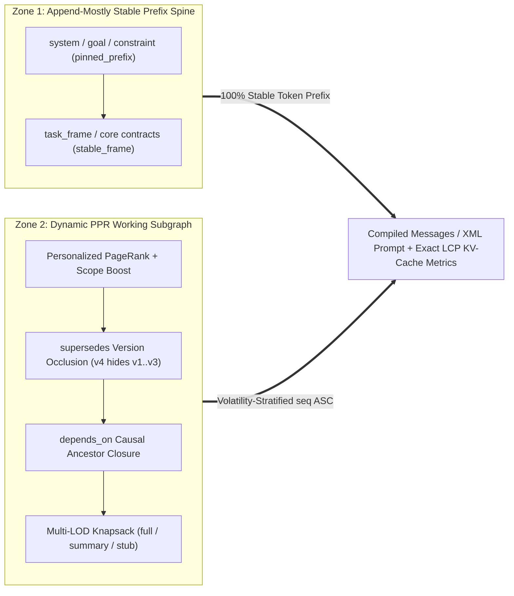

# `@opc/context-graph`

Zero-dependency **Two-Zone KV-Cache-Aware Property DAG** context manager, compiler, HTTP REST microservice, and MCP server for long-horizon coding and general-purpose AI agents.

Built natively on Node.js >= 23.6 / v26 (`node:sqlite`, `node:http`, `node:crypto`, `node:test`) with **zero external runtime dependencies**.

---

## Why Context Graph?

Mainstream agent loops represent working memory as an append-only 1D `messages[]` array, creating a severe trilemma on multi-turn tasks:

1. **Context Rot (`linear_full`)**: Editing `src/auth.ts` across `v1 -> v2 -> v3 -> v4` and hitting debugging dead ends leaves obsolete code snapshots and stack traces in context, causing contradictory state interference and $O(T^2)$ token bloat.
2. **Constraint Amnesia & Cache Shift (`linear_sliding_window`)**: Truncating oldest messages evicts Turn 1–3 architectural/security invariants and shifts token index `0` on every turn—destroying the Transformer Prefix KV-Cache.
3. **Version Collision & Cache Destruction (`naive_vector_rag`)**: Re-ranking chunks by cosine similarity retrieves conflicting versions (`v1..v4`) of the same file simultaneously while dropping Prefix KV-Cache hit rates to `< 2%` (5x–10x prefill cost spike).

### The Solution: Two-Zone KV-Cache-Aware Property DAG



---

## 32-Turn Multi-File Engineering Benchmark

Reproduce locally in `< 0.2s` via `npm run benchmark` (`40%` token budget = `3,235` tokens vs. `8,088` full linear tokens; `0.1x` cached token pricing):

| Strategy | Budget Compliant | Final Tokens (Budget) | Critical Constraint Recall | Latest State Accuracy (No Conflict) | Stale Token Ratio | Prefix KV-Cache Hit Rate | Effective Cost Index (Sliding=100) |
| :--- | :---: | :---: | :---: | :---: | :---: | :---: | :---: |
| `linear_full` | NO (Over) | 8088 / 3235 | 100.0% | 0.0% | 46.9% | 94.1% | **36.4** (20957 tok) |
| `linear_sliding_window` | YES | 2970 / 3235 | 0.0% | 66.7% | 19.0% | 31.6% | **100.0** (57532 tok) |
| `naive_vector_rag` | YES | 3225 / 3235 | 0.0% | 0.0% | 70.0% | 1.9% | **142.4** (81919 tok) |
| **`context_graph_two_zone`** | **YES** | **3062 / 3235** | **100.0%** | **100.0%** | **0.0%** | **66.6%** | **47.2** (27132 tok) |

See [`docs/RESEARCH.md`](./docs/RESEARCH.md) for theoretical proofs and [`docs/EVALUATION.md`](./docs/EVALUATION.md) for sensitivity sweeps and `@ppeng/agent-loop` integration patterns.

---

## Quickstart

Requires **Node.js >= 23.6** (tested on Node `v26.7.0`). No `npm install` required!

```bash
# Run full 23-case test suite (SQLite DAG, Compiler, HTTP E2E, MCP stdio, Benchmark)
npm test

# Run strict TypeScript check
npm run typecheck

# Run the 32-turn comparative benchmark
npm run benchmark

# Run live multi-turn compilation + Mermaid topology demo
npm run demo

# Start HTTP REST microservice on http://127.0.0.1:52341
npm start
```

---

## Programmatic SDK Usage

```ts
import { GraphStore, compileContext } from "@opc/context-graph";

const store = new GraphStore(":memory:"); // or "data/context-graph.db"
const graph = store.createGraph({ name: "Auth Refactor Session", defaultBudget: 3200 });

// Turn 1: Pin global security constraints + initial file snapshot
store.ingestTurn(graph.id, {
  turn: 1,
  scope: "auth",
  system: "You are a security-focused TypeScript coding agent.",
  constraints: [{ id: "c_hmac", content: "MUST use crypto.timingSafeEqual for MAC checks." }],
  artifacts: [{ path: "src/auth.ts", content: "export const verify = (a: string, b: string) => a === b;" }],
});

// Turn 2: New snapshot with matching resourceKey ("file:src/auth.ts") automatically supersedes v1
store.ingestTurn(graph.id, {
  turn: 2,
  scope: "auth",
  userMessage: "Harden src/auth.ts to enforce constant-time comparison.",
  artifacts: [
    {
      path: "src/auth.ts",
      content: "import { timingSafeEqual } from 'node:crypto';\nexport const verifyV2 = timingSafeEqual;",
      dependsOn: ["c_hmac"],
    },
  ],
});

const compiled = compileContext(store, {
  graphId: graph.id,
  focusQuery: "Verify hardened src/auth.ts implementation",
  activeScope: "auth",
  maxTokens: 2000,
});

console.log(compiled.kvCache);      // { totalTokens, prefixCachedTokens, prefixHitRate, ... }
console.log(compiled.messages);     // OpenAI-compatible ChatMessage[]
console.log(store.toMermaid(graph.id));
```

---

## HTTP REST Microservice API

Default address: `http://127.0.0.1:52341` (override via `PORT`, `HOST`, `DATA_PATH` env vars).

| Method & Path | Description |
| :--- | :--- |
| `GET /health` | Health check (`{ ok: true, service: "context-graph", version: "0.1.0", graphsCount, ... }`) |
| `POST /v1/graphs` | Create a new Context Graph (`{ id?, name, description?, defaultBudget? }`) |
| `GET /v1/graphs` | List all persisted Context Graphs |
| `GET /v1/graphs/:id` | Retrieve full graph metadata, stats, nodes, and edges |
| `POST /v1/graphs/:id/nodes` | Add a node (auto-versions & links `supersedes` on matching `resourceKey`) |
| `PATCH /v1/graphs/:id/nodes/:nodeId` | Update node status (`active` / `superseded` / `retracted`), tier, or salience |
| `POST /v1/graphs/:id/edges` | Link nodes (`depends_on`, `supersedes`, `summarizes`, `elaborates`, `scoped_to`, `conflicts_with`); rejects cycles (`400`) |
| `POST /v1/graphs/:id/ingest` | Atomic turn ingestion (`system`, `goal`, `constraints`, `decisions`, `artifacts`, `toolCalls`, `retractScopes`) |
| `POST /v1/graphs/:id/compile` | Run Two-Zone Graph Splicer & return `messages`, `promptText`, `kvCache`, `diagnostics` |
| `GET /v1/graphs/:id/mermaid` | Export Mermaid DAG (`?format=text` for `text/plain` or JSON) |
| `POST /v1/benchmark` | Execute the 32-turn comparative benchmark online and return full JSON metrics |

---

## MCP Server (`stdio` JSON-RPC 2.0)

Add to your MCP client configuration (`claude_desktop_config.json`, Cursor, Antigravity, Codex):

```json
{
  "mcpServers": {
    "context-graph": {
      "command": "node",
      "args": ["/Users/penglei/developer/ai-github/context-graph/src/cli.ts", "mcp"],
      "env": {
        "DATA_PATH": "/Users/penglei/developer/ai-github/context-graph/data/context-graph.db"
      }
    }
  }
}
```

Exposed MCP Tools:
- `cg_create_graph`
- `cg_add_node`
- `cg_link_nodes`
- `cg_ingest_turn`
- `cg_compile_context`
- `cg_export_mermaid`

---

## Repository Structure

```text
context-graph/
├── docs/
│   ├── RESEARCH.md            # Formal DAG model, Two-Zone compiler & 0.1x Cache Tax theory
│   └── EVALUATION.md          # 32-turn benchmark analysis, sensitivity sweep & integration guide
├── src/
│   ├── types.ts               # NodeKind, EdgeKind, ContextTier, CompileResult & Benchmark types
│   ├── vector.ts              # Deterministic token IDs, LCP analyzer, 128-d semantic vectors & LOD summarizer
│   ├── graph-store.ts         # node:sqlite Property DAG store, auto-supersedes, cycle detection & Mermaid
│   ├── compiler.ts            # Two-Zone KV-Cache-Aware Graph Splicer (PPR + Closure + Multi-LOD)
│   ├── server.ts              # HTTP REST microservice (127.0.0.1:52341)
│   ├── mcp.ts                 # Standard JSON-RPC 2.0 over stdio MCP Server
│   ├── benchmark.ts           # 32-turn multi-file engineering agent benchmark suite
│   ├── cli.ts                 # CLI entrypoint (serve | mcp | benchmark | demo)
│   ├── index.ts               # Public package exports
│   ├── node-builtins.d.ts     # Zero-dependency Node >= 23.6 / v26 ambient types for strict tsc
│   └── context-graph.test.ts  # 23 end-to-end unit, protocol & benchmark assertion tests
├── LICENSE
├── README.md
├── package.json
└── tsconfig.json
```

## License

MIT
