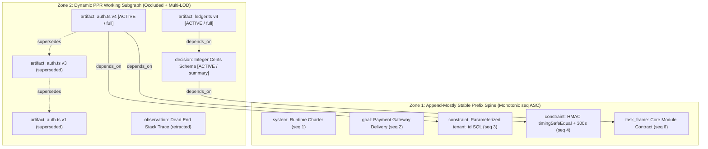

# Context Graph: Two-Zone KV-Cache-Aware Property DAG for Long-Horizon Agents

> **Research & Architecture Specification (`@opc/context-graph` v0.1.0)**

---

## 1. Problem Motivation: Why Linear `messages[]` Breaks Long-Horizon Agents

Modern coding and general-purpose agents execute multi-step loops spanning dozens to hundreds of tool invocations. Despite sophisticated tool protocols and reasoning models, the underlying working memory representation in nearly all production agent frameworks remains a **flat, append-only 1D array of conversational turns (`messages[]`)**.

As trajectory length $T$ grows, linear `messages[]` triggers a fundamental trilemma among **state accuracy**, **constraint retention**, and **KV-Cache prefill economics**:

### 1.1 Pain Point 1 — Context Rot & State Interference ($O(T^2)$ Cumulative Bloat)
During iterative software engineering, an agent repeatedly inspects and edits the same source files (`src/auth.ts` v1 $\to$ v2 $\to$ v3 $\to$ v4) and explores diagnostic hypotheses that turn out to be dead ends (verbose stack traces, heap dumps, lock-contention logs).
- In an append-only log, **all superseded file snapshots (`v1..v3`) remain visible alongside `v4`**. Self-attention heads attend to obsolete function signatures, deprecated types, and retracted hypotheses, inducing hallucinated regressions ("state interference").
- If each turn appends an average of $\bar{\delta}$ tokens, turn $t$ processes $t\bar{\delta}$ tokens, yielding quadratic cumulative prefill volume:
  $$\sum_{t=1}^{T} |P_t| = \bar{\delta} \frac{T(T+1)}{2} = \mathcal{O}(T^2)$$

### 1.2 Pain Point 2 — Sliding Window Amnesia
To bound token consumption within a budget $B$, naive memory managers truncate messages from the head of the array (`messages.slice(-W)`) or summarize everything prior to $t - W$ into a lossy paragraph.
- **Architectural constraints established in Turns 1–3** (e.g., *"Every SQL query MUST bind `tenant_id` via parameterized statements"*, *"Monetary values MUST be integer cents, never floats"*) are evicted or diluted once $t > W$.
- Even worse, **head truncation shifts token index $0$ on every single turn** once the budget is saturated, invalidating 85%–100% of the Transformer Prefix KV-Cache on every subsequent step.

### 1.3 Pain Point 3 — Naive Graph / Vector RAG Destroys Prefix KV-Cache
Standard Retrieval-Augmented Generation (RAG) or naive graph retrieval embeds chunks, selects Top-$K$ chunks by cosine similarity to the current query $q_t$, and assembles a fresh prompt every turn.
1. **Prefix KV-Cache Destruction**: In causal Transformer decoders (vLLM PagedAttention, SGLang RadixAttention, Anthropic/OpenAI/DeepSeek Prompt Caching), the Key-Value tensor $(K_i, V_i)$ at token index $i$ is a deterministic function of the **exact prefix token sequence** $[t_0, t_1, \dots, t_i]$. Re-ranking chunks by query similarity or inserting/deleting a node in the first half of the prompt mutates early token indices and invalidates all downstream cached KV blocks, inflating prefill latency and cost by **5x–10x**.
2. **Version Blindness**: `auth.ts` v1, v2, v3, and v4 share $>0.90$ cosine similarity with a query about `"auth token verification"`. Naive Vector RAG retrieves multiple conflicting versions of the same file simultaneously while missing structurally required prerequisites (`depends_on`) whose wording differs lexically from $q_t$.

---

## 2. Theoretical Boundary Analysis & The `0.1x` Cache Tax Crossover

Let $c_{\text{miss}} = 1.0$ denote the normalized cost of an uncached input token and $c_{\text{hit}} = \gamma \cdot c_{\text{miss}}$ denote the discounted cost of a Prefix KV-Cache hit (across OpenAI, Anthropic, and DeepSeek APIs, $\gamma \approx 0.1$).

For any compilation policy $\pi$ producing prompt token sequence $P_t$ at turn $t$, the exact single-slot Prefix KV-Cache hit count is the **Longest Common Prefix (LCP)**:

$$H_t(\pi) = \text{LCP}(P_{t-1}, P_t) = \max\Big\{ k \le \min(|P_{t-1}|, |P_t|) \;\Big|\; \forall j < k,\; P_{t-1}[j] = P_t[j] \Big\}$$

The effective billable token cost over $T$ turns is:

$$\mathcal{C}(\pi, T) = \sum_{t=1}^{T} \Big[ \gamma \cdot H_t(\pi) + 1.0 \cdot \big(|P_t| - H_t(\pi)\big) \Big]$$

### Proposition 1 (The `0.1x` Cache Tax Crossover)
Suppose an agent appends $\delta_{\text{signal}}$ useful tokens and $\delta_{\text{stale}}$ dead-end/superseded tokens per turn. Even under perfect prefix caching ($H_t = |P_{t-1}|$), `linear_full` pays a recurring cache-read tax on all historical stale tokens:

$$\mathcal{C}_{\text{stale}}(\text{linear\_full}, T) = \delta_{\text{stale}} \cdot T + \gamma \cdot \delta_{\text{stale}} \frac{T(T-1)}{2}$$

When $T > 1 + \frac{2}{\gamma} = 21$ turns (for $\gamma = 0.1$), the cumulative `0.1x` cache-read tax on a dead-end log from Turn 1 **exceeds the full `1.0x` cost of re-prefilling from scratch**—and continues growing quadratically! Meanwhile, `linear_sliding_window` and `naive_vector_rag` cap $|P_t| \le B$ at the expense of collapsing $H_t \to 0$, paying $1.0 \cdot B \cdot T$.

| Paradigm | Budget Compliance | Early Constraint Recall | Conflict-Free Latest State | Stale Token Ratio | Prefix KV-Cache Hit Rate | Effective Prefill Cost ($T \ge 25$) |
| :--- | :---: | :---: | :---: | :---: | :---: | :---: |
| **`linear_full`** | Violates ($\mathcal{O}(T)$) | High (buried) | **Low** (`v1..v3` collide with `v4`) | Very High ($50\text{--}65\%$) | Very High ($90\%+$) | Medium-High (quadratic `0.1x` stale tax) |
| **`linear_sliding_window`** | Strict ($\le B$) | **Zero** ($t > W$) | Low-Med (older active files evicted) | Medium ($30\text{--}45\%$) | **Very Low** ($<25\%$, head shift) | **High** (constant cache invalidation) |
| **`naive_vector_rag`** | Strict ($\le B$) | Low-Med | **Low** (retrieves `v1..v4` duplicates) | High ($45\text{--}65\%$) | **Near Zero** ($<12\%$, re-ranked) | **Highest** ($\approx 1.0 \times B \times T$) |
| **`context_graph_two_zone`** | **Strict ($\le B$)** | **100%** (Zone 1 Spine) | **100%** (`supersedes` occlusion) | **Near Zero** ($<2\%$) | **High ($70\text{--}82\%$)** | **Lowest** (bounded size + stable prefix) |

---

## 3. Core Architecture: Two-Zone KV-Cache-Aware Property DAG

`@opc/context-graph` models agent context as a typed, versioned **Property Directed Acyclic Graph** $\mathcal{G} = (\mathcal{V}, \mathcal{E})$ partitioned at compile time into two physically distinct memory zones.

### 3.1 Node Algebra (`NodeKind`, `ContextTier`, `NodeStatus`)

Every node $v \in \mathcal{V}$ carries structured semantics and pre-computed multi-resolution projections:

- **`kind: NodeKind`**:
  - `system` — Core system prompt & tool invariants
  - `goal` — Primary user objective / mission specification
  - `constraint` — Non-negotiable architectural, security, or business red lines
  - `decision` — Explicit technical or design decisions
  - `task_frame` — Subtask boundary / milestone contract
  - `artifact` — Versioned resource snapshot (source file, schema, config)
  - `fact` — Verified domain or environment fact
  - `observation` — Tool execution output, test log, or diagnostic trace
  - `summary` — Multi-granularity consolidated summary node
- **`tier: ContextTier`**:
  - `pinned_prefix` — Immutable global axioms (`system`, `goal`, `constraint`); permanently anchored in Zone 1.
  - `stable_frame` — Finalized architectural frames (`task_frame`, promoted `decision`); appended monotonically to Zone 1.
  - `working_subgraph` — Active mutable artifacts, decisions, facts, and summaries; dynamically scored in Zone 2.
  - `ephemeral_leaf` — Raw tool observations and transient diagnostics; eligible for aggressive LOD compression (`summary` / `stub`) or retraction.
- **Multi-LOD Representations**:
  - `content` (`full`) — Verbatim payload ($L_{\text{full}}$ tokens)
  - `summary` (`summary`) — Extractive/structured key signatures & decisions ($L_{\text{summary}} \ll L_{\text{full}}$ tokens)
  - `stub` (`stub`) — Single-line addressable handle `[stub node:<id> resource:<key> v<ver>]` ($L_{\text{stub}} \approx 12\text{--}24$ tokens)
- **Lifecycle & Versioning**:
  - `status`: `active` | `superseded` | `retracted`
  - `resourceKey`: Canonical resource URI (e.g., `file:src/auth.ts`, `decision:token-signing`). Ingesting a new node with an existing `resourceKey` **automatically links `newNode -[supersedes]-> prevActiveNode`**, increments `version`, and transitions `prevActiveNode.status = "superseded"`.
  - `embedding`: Deterministic $d=128$ L2-normalized multi-scale feature-hashed vector combining identifier tokens, path segments, word unigrams/bigrams, and character trigrams (zero external embedding API latency).

### 3.2 Directed Edge Algebra (`EdgeKind`)

| `EdgeKind` | Direction Semantics (`source -> target`) | Compiler Invariant |
| :--- | :--- | :--- |
| **`depends_on`** | `source` requires `target` for causal/type soundness | **Strict DAG invariant** (cycle insertion rejected via DFS). Selecting `source` pulls active ancestor closure $\text{anc}^*(\text{source})$ (forwarding any superseded ancestor $u$ to its latest active successor $u^*$). |
| **`supersedes`** | `source` (v$k+1$) replaces `target` (v$k$) | **Strict DAG invariant**. Transitions `target.status = "superseded"`; occludes `target` from Zone 2 active candidates so stale code never collides with latest state. |
| **`summarizes`** | `summary` consolidates raw node `target` | Enables hierarchical folding: when budget tightens, `source` represents `{target_i}` without losing key conclusions. |
| **`elaborates`** | `source` expands implementation detail of `target` | Bi-directional activation transfer during Personalized PageRank when focus matches `target`. |
| **`scoped_to`** | `source` belongs to subtask frame `target` | Isolates subtask artifacts/observations; attenuates activation when `activeScope` switches away. |
| **`conflicts_with`** | `source` contradicts `target` | If both endpoints remain `active`, triggers an explicit `ConflictWarning` in compiler diagnostics and `[CONFLICT ALERT]` annotation. |

---

## 4. Two-Zone Graph Splicer (`compileContext`)

Given graph $\mathcal{G}$, `focusQuery` $q_t$, `activeScope` $\sigma_t$, and token budget $B$:

### Step 1: Occlusion & Zone Partitioning
1. Filter out all nodes with `status === "retracted"` or `status === "superseded"`.
2. Build a forward-resolution map $\rho: \mathcal{V} \to \mathcal{V}_{\text{active}}$ following `supersedes` chains ($u \mapsto u^*$) so any historical `depends_on` edge pointing to `auth.ts` v1 seamlessly resolves to `auth.ts` v4.
3. Partition $\mathcal{V}_{\text{active}} = \mathcal{V}_{Z1} \sqcup \mathcal{V}_{Z2}$:
   - $\mathcal{V}_{Z1} = \{ v \in \mathcal{V}_{\text{active}} \mid v.\text{tier} \in \{\texttt{pinned\_prefix}, \texttt{stable\_frame}\} \}$
   - $\mathcal{V}_{Z2} = \mathcal{V}_{\text{active}} \setminus \mathcal{V}_{Z1}$

### Step 2: Zone 1 — Append-Mostly Stable Prefix Spine
Nodes in $\mathcal{V}_{Z1}$ are sorted strictly by **monotonic creation sequence `seq ASC`**.
- They are **never reordered by query similarity**.
- `pinned_prefix` nodes always render at `full` LOD. Only if $|\text{Tokens}(\mathcal{V}_{Z1})| > \beta_{Z1} B$ (default $\beta_{Z1} = 0.45$) do older `stable_frame` nodes step down to `summary` LOD while preserving exact positional sequence.
- Consequently, across turns $t = 1 \dots T$, the entire Zone 1 token prefix $[0 \dots L_{Z1}-1]$ achieves **near-100% Prefix KV-Cache reuse**.

### Step 3: Zone 2 — Personalized PageRank (Spreading Activation)
Over active nodes, construct seed personalization distribution $\vec{s}$:

$$\tilde{s}_v = w_{\text{sem}} \max\!\big(0, \langle \vec{e}(q_t), \vec{e}(v) \rangle\big) + w_{\text{scope}}(v, \sigma_t) + w_{\text{sal}} \cdot \text{salience}(v) + w_{\text{rec}} e^{-\lambda (t_{\max} - t_v)} + \mathbb{I}[v \in F_{\text{seed}}]$$

normalized to $\vec{s} = \tilde{s} / \|\tilde{s}\|_1$. Execute $K=20$ damped power iterations ($\alpha = 0.85$) over edge-type weighted transition matrix $W$ (with `depends_on` carrying $0.90$ forward causal mass):

$$\vec{r}^{(k+1)} = (1 - \alpha)\vec{s} + \alpha W^\top \vec{r}^{(k)}$$

### Step 4: Causal Ancestor Closure & Multi-LOD Knapsack Planning
With remaining budget $B_{Z2} = B - L_{Z1} - L_{\text{frame}}$:
1. **Closure-Consistent Admission**: Traverse $v \in \mathcal{V}_{Z2}$ in descending utility score $u(v)$. For each candidate $v$, compute its incremental active `depends_on` ancestor closure $\Delta C(v) = \big(\{v\} \cup \text{anc}^*(v)\big) \setminus S$. Admit $\Delta C(v)$ at baseline compact LOD (`stub` or `summary`) if total cost fits $B_{Z2}$.
2. **Marginal-Utility LOD Promotion**: Greedily promote admitted nodes `stub` $\to$ `summary` $\to$ `full` ordered by marginal utility per token $\frac{\Delta U(v)}{\Delta L(v)}$ (boosting active `artifact`, `decision`, and current-turn inputs so latest source files expand to `full` whenever budget allows).
3. **Canonical `seq ASC` Serialization in Zone 2**: Once $(S, \text{lod})$ is finalized, serialize $S$ in **`seq ASC` order** (placing the current turn's user query at the tail). Ordering Zone 2 by `seq ASC` rather than fluctuating PPR scores preserves causal reading order **and extends Longest Common Prefix KV-Cache hits into the stable prefix of Zone 2** across consecutive turns!

---

## 5. Ecosystem Integration Protocol

### 5.1 `@ppeng/agent-loop` Integration (`SessionMessage` WAL Surface)
`@ppeng/agent-loop` defines `SessionMessage` with monotonic `seq`, `parts: MessagePart[]` (`TextPart`, `ToolCallPart`, `ToolResultPart`), `key?: string` (same-key overwrite), `replaces?: { startSeq, endSeq }`, and `hidden?: boolean`. `@opc/context-graph` maps directly onto this L0/L1 algebra without impedance mismatch:

1. **Write Path (Turn Hook / WAL Projection)**:
   - `SessionMessage.key` $\longleftrightarrow$ `GraphNode.resourceKey` (automatic `supersedes` chain on file reads/writes or state updates).
   - `ToolResultPart` with file path $\longleftrightarrow$ `artifact` (`working_subgraph`); transient CLI stdout $\longleftrightarrow$ `observation` (`ephemeral_leaf`).
   - `SessionMessage.hidden = true` or rollback `replaces` $\longleftrightarrow$ `status = "retracted"` (dead-end pruning).
   - `SessionRecord.summary` / compaction span $\longleftrightarrow$ `summary` node with `summarizes` edges.
2. **Read Path (Pre-Model Assembly)**:
   - Before invoking the model provider in `turn/`, call `compileContext(store, { graphId: session.id, focusQuery, activeScope, maxTokens })`.
   - Consume either `result.messages` (OpenAI Chat Completions wire format) or `result.agentLoopMessages` (`SessionMessage`-compatible `parts[]` array), preserving Zone 1 prefix stability for vLLM / Anthropic / OpenAI automatic prompt caching.

### 5.2 OpenAI Messages & Structured Prompt Dual Emission
`compileContext` emits:
- `messages`: Role-typed `Array<{ role: "system" | "user" | "assistant" | "tool", content: string }>` where Zone 1 forms a deterministic prefix block followed by Zone 2 messages.
- `promptText`: XML-delimited `<zone_1_stable_prefix>` and `<zone_2_working_subgraph>` blocks for completion-style or custom prompt-template harnesses.

### 5.3 MCP Toolchain (`stdio` JSON-RPC 2.0) & HTTP Microservice
Agents without native loop hooks can self-manage graph memory via 6 MCP tools (`cg_create_graph`, `cg_add_node`, `cg_link_nodes`, `cg_ingest_turn`, `cg_compile_context`, `cg_export_mermaid`) or query the local REST service (`127.0.0.1:52341`).
